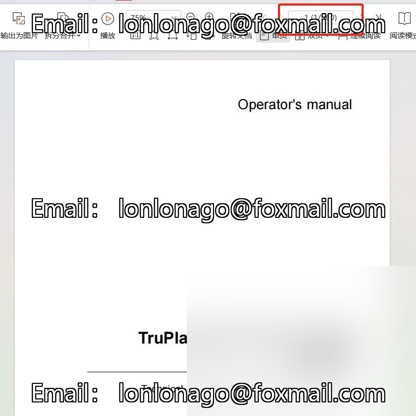
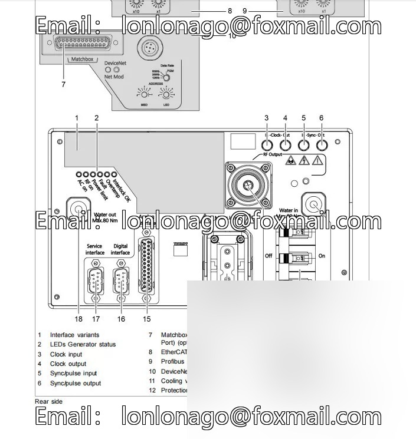
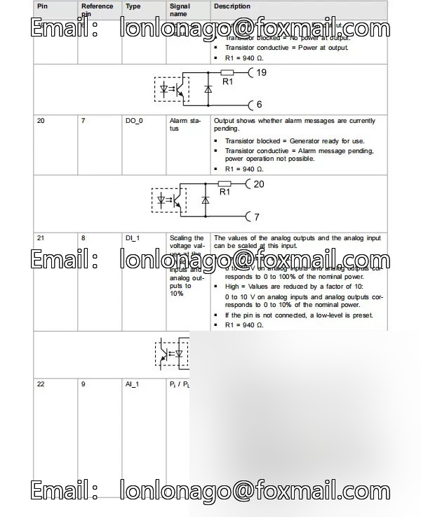
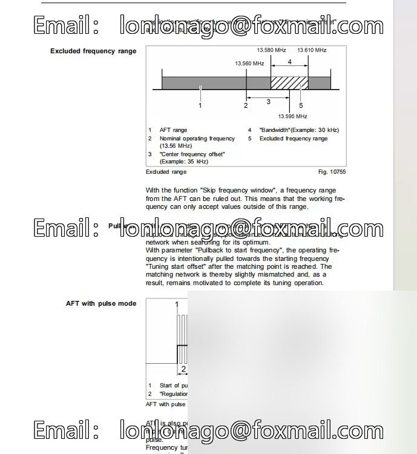
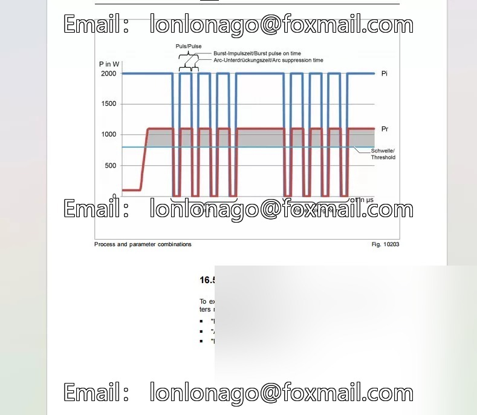

# # Material RF Plasma TruPlasma RF technical specifications and operator manual

## Body

# Material RF plasma TruPlasma RF technical specifications and operator manual   There are 360 pages

Take a photo and directly send the electronic original file! Since the electronic file materials have copyability, it is not allowed to return the purchase for electronic files! Thank you for understanding!

The document covers the TruPlasma RF technology specification and operator manual, with a total of 360 pages; it includes rotating documents, technical specifications, output status and signal descriptions.

<!-- AI_ENRICHED -->

## Images

## Payment

Here is a pay link on Stripe ( https://buy.stripe.com/3cs8yP7sY87d0vu9AB ). Please contact me lonlonago@foxmail.com after funding $89, and I will send you a complete data files , thank you!

